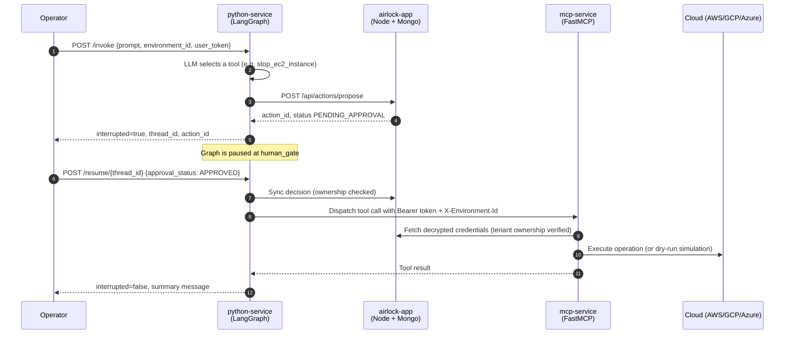

# MultiMesh (Airlock)

**A zero-trust control plane that puts an encrypted credential vault and a mandatory human approval gate between an autonomous AI agent and live cloud infrastructure.**

An LLM agent (LangGraph + Azure OpenAI) can *propose* cloud operations such as stopping an EC2 instance, but it can never *execute* one on its own, and it never sees your cloud credentials. Every mutating action pauses at a Human-in-the-Loop (HITL) gate, is recorded in a tenant-scoped state machine, and only runs after an authenticated operator approves it.

---

## Table of Contents

- [Architecture](#architecture)
- [How a Request Flows](#how-a-request-flows)
- [Design Highlights](#design-highlights)
- [Services](#services)
- [API Overview](#api-overview)
- [Repository Structure](#repository-structure)
- [Quick Start](#quick-start)
- [Testing](#testing)
- [Security Notes](#security-notes)
- [Roadmap](#roadmap)

---

## Architecture

```text
                    +-------------------------------------+
                    |      React Control Plane (:5173)    |
                    |  Inventory | Agent Chat | Approvals  |
                    +------+--------------------+---------+
                           |                    |
                REST / WebSocket          /invoke, /resume
                           |                    |
                           v                    v
        +------------------------------+   +--------------------------+
        |   airlock-app (:3000)        |   |  python-service (:8000)  |
        |   Node.js + Express + Mongo  |<--|  FastAPI + LangGraph     |
        |                              |   |                          |
        |  - JWT multi-tenant auth     |   |  - Azure OpenAI planner  |
        |  - AES-256-GCM secret vault  |   |  - Checkpointed state    |
        |  - HITL action state machine |   |  - human_gate interrupt  |
        |  - Ownership enforcement     |   |  - Token redaction       |
        +--------------+---------------+   +------------+-------------+
                       ^                                |
                       |  fetch credentials             |  dispatch approved
                       |  (caller's JWT)                |  tool call
                       |                                v
                       |                   +--------------------------+
                       +-------------------|   mcp-service (:8001)    |
                                           |   FastMCP + ProviderFactory
                                           |                          |
                                           |  - Per-request context   |
                                           |  - AWS / GCP / Azure     |
                                           |  - Dry-run / live mode   |
                                           +--------------------------+
```

---

## How a Request Flows



If the operator rejects the action, the graph resumes with `REJECTED` and no tool is ever dispatched to `mcp-service`.

---

## Design Highlights

### 1. Credential isolation with an encrypted vault
- Cloud keys are encrypted at rest in MongoDB with **AES-256-GCM** (random IV, authenticated tag).
- The LLM orchestrator never receives cloud credentials. Only `mcp-service` retrieves them, at execution time, using the calling user's identity.
- Environment APIs never echo `accessKey` / `secretKey` back to the client.

### 2. Deterministic Human-in-the-Loop state machine
- Every mutating tool call is turned into an action in the Airlock with an explicit lifecycle: `PENDING_APPROVAL` -> `APPROVED` or `REJECTED`.
- The LangGraph agent pauses at a `human_gate` node using `interrupt()` and continues only through `Command(resume=...)` after a decision arrives.
- Invalid transitions (for example rejecting an already-approved action) are refused by the gateway.

### 3. Multi-tenant isolation at every hop
- JWT authentication on the gateway; every action and environment is owned by a user.
- A different tenant using someone else's `environment_id` is rejected with `403` by the gateway, surfaced as `502` by the agent service, and blocked again at the MCP boundary.
- Another user cannot resume your paused thread.

### 4. Checkpoint hygiene
- Agent state is persisted with an async SQLite checkpointer so paused threads survive restarts.
- `GET /state/{thread_id}` returns the checkpoint with `user_token` redacted, so inspecting a thread never reveals a JWT.

### 5. Open-Closed provider architecture
- `ProviderFactory` decouples tool endpoints from vendor SDKs. `AWSProvider`, `GCPProvider` and `AzureProvider` register against a shared base class; adding a cloud means adding a class, not editing the dispatcher.
- Unsupported operations return an explicit "not implemented" error instead of faking success.

### 6. Safe by default execution
- `mcp-service` runs in **dry-run mode** by default and returns deterministic simulated results (for example `StopInstances` -> `stopping`).
- Live execution requires explicitly turning dry-run off (see `mcp-microservice/config.py`).

---

## Services

| Service | Port | Stack | Responsibility |
|---|---|---|---|
| `airlock-app` | 3000 | Node.js, Express, MongoDB | Auth, encrypted vault, action state machine |
| `python-service` | 8000 | FastAPI, LangGraph, Azure OpenAI | Agent planning, HITL pause/resume, checkpoints |
| `mcp-service` | 8001 | FastMCP, Starlette, provider SDKs | Credential-scoped tool execution |
| `airlock-ui` | 5173 | React, Vite | Inventory view, agent chat, approval console |
| `airlock-mongo` | 27017 | MongoDB | Persistence for the gateway |

---

## API Overview

### Airlock gateway (`:3000`)

| Method | Path | Purpose |
|---|---|---|
| `GET` | `/health` | Liveness |
| `POST` | `/api/auth/register` | Create a user |
| `POST` | `/api/auth/login` | Obtain a JWT |
| `POST` | `/api/environments` | Vault a cloud environment (credentials encrypted) |
| `GET` | `/api/environments` | List environments (credentials redacted) |
| `POST` | `/api/actions/propose` | Propose an action (enters `PENDING_APPROVAL`) |
| `GET` | `/api/actions/pending` | List actions awaiting a decision |
| `POST` | `/api/actions/:id/approve` | Approve an action |
| `POST` | `/api/actions/:id/reject` | Reject an action |

### Agent service (`:8000`)

| Method | Path | Purpose |
|---|---|---|
| `GET` | `/health` | Liveness |
| `POST` | `/invoke` | Run the agent: `{prompt, environment_id, user_token}` |
| `POST` | `/resume/{thread_id}` | Resume a paused thread: `{approval_status, user_token}` |
| `GET` | `/state/{thread_id}` | Inspect a checkpoint (token redacted) |

### MCP service (`:8001`)

| Method | Path | Purpose |
|---|---|---|
| `GET` | `/health` | Liveness, registered providers, dry-run flag |
| `POST` | `/tools/{name}` | REST tool dispatch (used by the agent service) |
| `GET` | `/sse` | MCP over SSE |

Context is passed per request via the `Authorization: Bearer <jwt>` and `X-Environment-Id` headers and is never part of tool schemas.

---

## Repository Structure

```text
MultiMesh/
├── airlock-backend/        # Node.js gateway: auth, vault, action state machine
├── python-microservices/   # FastAPI + LangGraph agent service
├── mcp-microservice/       # FastMCP service + ProviderFactory
├── airlock-ui/             # React + Vite control plane
├── airlock-cli.ps1         # Interactive PowerShell terminal client
└── docker-compose.yml      # Orchestration for the backend stack
```

---

## Quick Start

### Prerequisites
- Docker and Docker Compose
- Node.js 18+ (for the UI)
- An Azure OpenAI / Azure AI Foundry deployment for the agent
- (Optional) PowerShell 5.1+ for the CLI client

### 1. Configure environment files
Copy each `.env.example` to `.env` in `airlock-backend/`, `python-microservices/` and `mcp-microservice/`, then fill in your own values (JWT secret, vault encryption key, Azure OpenAI endpoint/key/deployment). **Never commit `.env` files.**

### 2. Start the backend stack
```bash
docker compose up -d --build
```

### 3. Verify the services
```bash
curl http://localhost:3000/health
curl http://localhost:8000/health
curl http://localhost:8001/health
```

### 4. Use it

**React control plane**
```bash
cd airlock-ui
npm install
npm run dev
```

**PowerShell CLI**
```powershell
# Credentials are read from AWS_ACCESS_KEY_ID / AWS_SECRET_ACCESS_KEY,
# or prompted for, and are never stored in the script.
.\airlock-cli.ps1
```

**Direct API example**
```bash
# 1) Ask the agent to stop an instance. It pauses and returns a thread_id and action_id.
curl -X POST http://localhost:8000/invoke \
  -H "Content-Type: application/json" \
  -d '{"prompt":"Stop EC2 instance i-0abc1234def567890","environment_id":"<ENV_ID>","user_token":"<JWT>"}'

# 2) Approve it. The tool executes through mcp-service.
curl -X POST http://localhost:8000/resume/<THREAD_ID> \
  -H "Content-Type: application/json" \
  -d '{"approval_status":"APPROVED","user_token":"<JWT>"}'
```

---

## Testing

End-to-end Postman collections cover the full path across all services:

1. **Gateway suite**: auth, vault redaction, HITL state machine.
2. **Agent + gateway suite**: conversational reply vs. tool interrupt, pause/resume, checkpoint redaction, cross-tenant rejection, request validation (`422`).
3. **Full 4-container suite**: MCP contract and provider verification, cross-tenant checks at every boundary, and the complete LangGraph -> Airlock -> MCP execution relay.

Import a collection into Postman and run it in order with the Collection Runner. The test environments use placeholder keys (`AKIA_TEST_*`) so runs stay in dry-run mode and never touch real infrastructure.

---

## Security Notes

- Treat `.env` files and any real cloud keys as secrets. Use a dedicated, least-privilege IAM identity (for example, only `ec2:StartInstances` / `ec2:StopInstances` on specific instances) when running in live mode.
- Rotate any credential that has ever been pasted into a terminal log, chat, script or commit.
- Keep dry-run enabled for development and CI. Enable live execution deliberately and only against non-critical resources first.
- Run dependency audits (`pip-audit`, `npm audit`) as part of CI and pin versions with a lockfile.

---

## Roadmap

- Streamable HTTP transport for the MCP endpoint alongside SSE
- Per-action audit trail and approver identity on every decision
- Role-based approval policies (for example, two-person approval for destructive actions)
- Expiry for pending actions
- Additional providers and tools

---

## License

Add your license here (for example MIT) before publishing.
